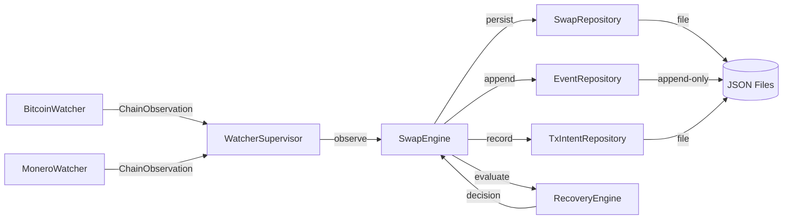

# Requirements

### Overview
Milestone 2 adds **persistent state, event log, watchers, reconciliation, and recovery** to the BTC-XMR atomic swap system. The acceptance criterion is: **kill either process at any point and restart it without losing the swap state.**

### Scope

**In Scope:**
- `opendex-events` crate — append-only event types and event sourcing
- `opendex-storage` crate — repository traits and file-based storage implementation
- `opendex-watchers` crate — blockchain watcher supervisor and mock watchers
- `opendex-recovery` crate — deterministic recovery engine
- Swap engine integration with persistence, watchers, and recovery
- Crash recovery test — simulate process restart and verify swap state is preserved

**Out of Scope:**
- P2P transport (Milestone 3)
- Order book / matching (Milestone 4)
- Public API / GUI (Milestone 5)
- Fiat subsystem (Milestone 6)
- PostgreSQL — file-based storage for M2, PostgreSQL later

### Key Requirements
1. **Event Sourcing** — every swap state change is recorded as an immutable event; the event log allows full reconstruction of swap state without trusting in-memory state.
2. **Persistent Storage** — swap records, events, and transaction intents are persisted to disk using atomic writes (building on the existing `p2p-node/persistence.rs` pattern).
3. **Watchers** — read-only blockchain observers that report observations to the swap engine via `ChainObservation`.
4. **Recovery Engine** — deterministic recovery that evaluates swap state + chain state and returns a `RecoveryDecision` (Wait, Redeem, Refund, Punish, Abort).
5. **Reconciliation** — on startup, compare database state against blockchain state to detect transactions that were broadcast but not recorded.
6. **Restart Test** — end-to-end test that creates a swap, persists it, simulates a crash, reloads state, and completes the swap.

# Technical Design

### Current Implementation (Milestone 1)
- 8 crates created: `opendex-types`, `opendex-errors`, `opendex-protocol-types`, `opendex-protocol`, `opendex-btc-xmr`, `opendex-bitcoin`, `opendex-monero`, `opendex-swap`
- `SwapEngine<P>` coordinates swaps but holds state only in memory
- `MockBitcoinChain` / `MockMoneroChain` exist but are not wired into a watcher loop
- `SwapState` transitions are validated but not persisted
- `p2p-node/persistence.rs` provides atomic file write utilities

### Key Decisions

**1. File-based storage for M2 (not PostgreSQL)**
The specs recommend PostgreSQL, but for M2 we use file-based JSON storage with atomic writes. This keeps the milestone focused on the persistence *patterns* (repositories, event log, reconciliation) without requiring a database dependency. PostgreSQL can be added later as a new backend behind the same repository traits.

**2. Four new crates: events, storage, watchers, recovery**
Following the spec's crate architecture exactly:
- `opendex-events` — event types only, no storage
- `opendex-storage` — repository traits + file-based implementation
- `opendex-watchers` — watcher supervisor + mock watchers
- `opendex-recovery` — deterministic recovery engine

**3. SwapEngine extended with persistence**
The `SwapEngine` will be extended to accept a `SwapRepository` and `EventRepository`. On each state transition, it will:
1. Append an event to the event log
2. Update the swap state in the repository
3. Record transaction intents before broadcast

**4. Watchers are read-only**
Per spec section 55: watchers report observations only; the protocol state machine decides what they mean. Watchers emit `ChainObservation` which the `SwapEngine` feeds into `protocol.observe_chain()`.

### Proposed Changes

#### New Crate: `opendex-events`
- `EventId` — unique event identifier
- `SwapEvent` enum — `SwapCreated`, `SwapStateChanged`, `FundingDetected`, `RedemptionDetected`, `RefundDetected`, `SwapCompleted`, `SwapFailed`
- Each event carries `swap_id`, `timestamp`, and sequence number
- Events are append-only, never modified

#### New Crate: `opendex-storage`
- `SwapRepository` trait — `create`, `get`, `update_state`, `list_incomplete`
- `EventRepository` trait — `append`, `load_after`, `load_for_swap`
- `TransactionIntentRepository` trait — `create`, `find`
- `FileSwapRepository` — JSON file-based implementation using atomic writes from `p2p-node/persistence.rs` pattern
- `FileEventRepository` — append-only JSON lines file
- `InMemorySwapRepository` — for testing without disk I/O

#### New Crate: `opendex-watchers`
- `WatcherSupervisor` — coordinates Bitcoin and Monero watchers
- `BitcoinWatcher` — polls `BitcoinChain`, emits `ChainObservation`
- `MoneroWatcher` — polls `MoneroChain`, emits `ChainObservation`
- `MockWatcher` — injects observations for testing
- Watchers are read-only; they never trigger actions directly

#### New Crate: `opendex-recovery`
- `RecoveryEngine` trait — `evaluate(state, chain_state) -> RecoveryDecision`
- `RecoveryDecision` enum — `Wait`, `Redeem`, `Refund`, `Punish`, `Abort`
- `DeterministicRecoveryEngine` — default implementation based on swap state + chain observations
- Recovery is deterministic: same inputs → same decision (testable)

#### Modified: `opendex-swap`
- `SwapEngine` extended with `SwapRepository`, `EventRepository`, and `TransactionIntentRepository`
- `persist_state()` — saves state after each transition
- `append_event()` — records events on state changes
- `reconcile()` — on startup, loads incomplete swaps and reconciles with chain state
- `recover()` — uses `RecoveryEngine` to evaluate and resume interrupted swaps

#### Modified: `opendex-protocol-types`
- Add `EventId` type
- Extend `ProtocolAction` if needed for reconciliation

#### Modified: `opendex-errors`
- Add `RecoveryError` variant to `OpenDexError`

### Architecture Diagram



### Data Models

#### SwapEvent
```rust
pub enum SwapEvent {
    SwapCreated { swap_id, trade_id, btc_amount, xmr_amount },
    SwapStateChanged { swap_id, from_state, to_state },
    FundingDetected { swap_id, chain, txid, amount, confirmations },
    RedemptionDetected { swap_id, chain, txid },
    RefundDetected { swap_id, chain, txid },
    SwapCompleted { swap_id },
    SwapFailed { swap_id, reason },
}
```

#### RecoveryDecision
```rust
pub enum RecoveryDecision {
    Wait,
    Redeem { chain: Asset },
    Refund { chain: Asset },
    Punish,
    Abort,
}
```

#### Repository Traits
```rust
pub trait SwapRepository {
    fn create(&self, swap: &Swap) -> Result<(), StorageError>;
    fn get(&self, id: SwapId) -> Result<Option<Swap>, StorageError>;
    fn update_state(&self, id: SwapId, state: SwapState) -> Result<(), StorageError>;
    fn list_incomplete(&self) -> Result<Vec<Swap>, StorageError>;
}

pub trait EventRepository {
    fn append(&self, event: SwapEvent) -> Result<EventId, StorageError>;
    fn load_after(&self, sequence: u64) -> Result<Vec<SwapEvent>, StorageError>;
    fn load_for_swap(&self, swap_id: SwapId) -> Result<Vec<SwapEvent>, StorageError>;
}
```

### File Structure
```
crates/
├── opendex-events/
│   ├── Cargo.toml
│   └── src/lib.rs          (EventId, SwapEvent enum)
├── opendex-storage/
│   ├── Cargo.toml
│   └── src/
│       ├── lib.rs          (repository traits + file impls)
├── opendex-watchers/
│   ├── Cargo.toml
│   └── src/
│       ├── lib.rs          (WatcherSupervisor, mock watchers)
├── opendex-recovery/
│   ├── Cargo.toml
│   └── src/lib.rs          (RecoveryEngine, RecoveryDecision)
├── opendex-swap/           (MODIFIED — persistence integration)
│   └── src/lib.rs
├── opendex-errors/         (MODIFIED — RecoveryError)
└── opendex-protocol-types/ (MODIFIED — EventId)
```

### Risks
- **File-based storage concurrency**: Atomic writes prevent corruption, but concurrent access needs Mutex or file locking. Mitigation: use `std::sync::Mutex` around file operations.
- **Event log growth**: Append-only events accumulate. Mitigation: M2 is proof-of-concept; pruning strategy comes later.
- **Recovery determinism**: Recovery must be fully deterministic. Mitigation: extensive property-based tests comparing decisions across identical inputs.

# Delivery Steps

### ✓ Step 1: Create opendex-events crate
Create the event types crate with SwapEvent enum, EventId, and event sourcing foundations.
- Create `crates/opendex-events/Cargo.toml` with dependencies on `opendex-types` and `opendex-errors`
- Implement `EventId` (UUID-based)
- Implement `SwapEvent` enum: `SwapCreated`, `SwapStateChanged`, `FundingDetected`, `RedemptionDetected`, `RefundDetected`, `SwapCompleted`, `SwapFailed`
- Each event carries `swap_id`, sequence number, and timestamp
- Add unit tests for event serialization and construction

### ✓ Step 2: Create opendex-storage crate
Create the storage crate with repository traits and file-based implementations.
- Create `crates/opendex-storage/Cargo.toml` with dependencies on `opendex-types`, `opendex-errors`, `opendex-events`, and `opendex-swap`
- Implement `SwapRepository` trait: `create`, `get`, `update_state`, `list_incomplete`
- Implement `EventRepository` trait: `append`, `load_after`, `load_for_swap`
- Implement `TransactionIntentRepository` trait: `create`, `find`
- Implement `FileSwapRepository` using atomic JSON writes (pattern from `p2p-node/persistence.rs`)
- Implement `FileEventRepository` as append-only JSON lines
- Implement `InMemorySwapRepository` and `InMemoryEventRepository` for testing
- Add tests for persistence round-trip and atomic write safety

### ✓ Step 3: Create opendex-watchers crate
Create the watchers crate with blockchain observation infrastructure.
- Create `crates/opendex-watchers/Cargo.toml` with dependencies on `opendex-types`, `opendex-errors`, `opendex-protocol-types`, `opendex-bitcoin`, and `opendex-monero`
- Implement `WatcherSupervisor` that coordinates Bitcoin and Monero watchers
- Implement `BitcoinWatcher` — polls `BitcoinChain`, emits `ChainObservation`
- Implement `MoneroWatcher` — polls `MoneroChain`, emits `ChainObservation`
- Implement `MockWatcher` — injects observations for testing without real chains
- Watchers are read-only: they report observations, never trigger actions
- Add tests for watcher observation emission and supervisor coordination

### ✓ Step 4: Create opendex-recovery crate
Create the recovery crate with deterministic recovery engine.
- Create `crates/opendex-recovery/Cargo.toml` with dependencies on `opendex-types`, `opendex-errors`, and `opendex-protocol-types`
- Implement `RecoveryDecision` enum: `Wait`, `Redeem`, `Refund`, `Punish`, `Abort`
- Implement `RecoveryEngine` trait: `evaluate(state, chain_state) -> RecoveryDecision`
- Implement `DeterministicRecoveryEngine` — default logic based on swap state + chain observations
- Add `RecoveryError` to `opendex-errors`
- Add tests for deterministic recovery: same inputs always produce same decision
- Test all recovery paths: refund, redeem, wait, abort

### ✓ Step 5: Integrate persistence into SwapEngine
Extend SwapEngine to use repositories, event log, watchers, and recovery.
- Modify `opendex-swap/src/lib.rs`:
  - Extend `SwapEngine` to accept `SwapRepository`, `EventRepository`, and `TransactionIntentRepository`
  - Add `persist_state()` — saves state after each transition
  - Add `append_event()` — records events on state changes
  - Add `reconcile()` — on startup, loads incomplete swaps and compares with chain state
  - Wire `RecoveryEngine` into the `recover()` method
  - Add `reconstruct_from_events()` — rebuild swap state from event log
- Modify `opendex-protocol-types` to export `Swap` struct
- Add integration test: create swap → persist → simulate crash → reload → complete swap
- Verify all existing tests still pass

### ✓ Step 6: Crash recovery end-to-end test
Write the Milestone 2 acceptance test — kill and restart without losing swap state.
- Create a comprehensive test in `opendex-swap` that:
  1. Creates a swap with `FileSwapRepository` and `FileEventRepository`
  2. Advances through state transitions (Created → Negotiating → ProtocolSetup → Funding)
  3. Simulates a crash (drop all in-memory state)
  4. Reloads swap state from repositories
  5. Reconciles with mock chain state
  6. Recovers and completes the swap (Funding → Funded → Redeeming → Completed)
  7. Verifies the event log contains all state transitions
  8. Verifies swap state matches event log reconstruction
- Run full test suite: `cargo test --workspace --lib` — all tests must pass
- Run `cargo check --workspace` — no errors