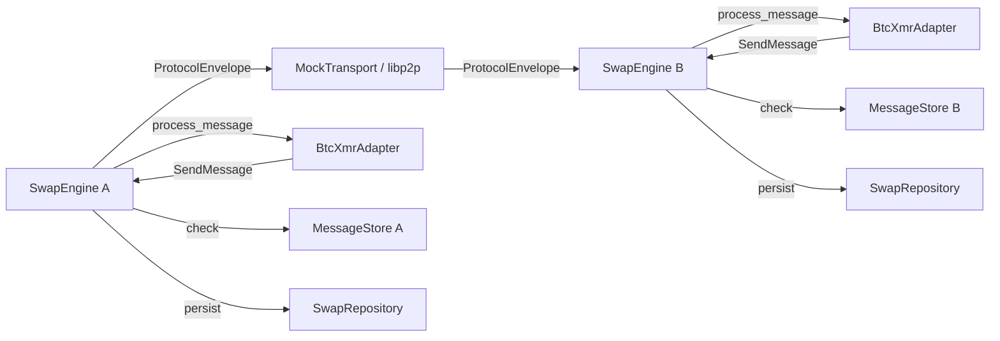

# Requirements

### Overview
Milestone 3 adds **P2P transport, peer discovery, and authenticated messaging** to the BTC-XMR atomic swap system. The acceptance criterion is: **the swap should no longer require local process-to-process coordination** — two independent processes can complete a swap over the network.

### Scope

**In Scope:**
- `opendex-transport` crate — Transport trait, ProtocolEnvelope, message envelope handling
- `opendex-chain` crate — generic chain abstraction trait
- Message replay protection — seen_message_ids tracking per swap
- Message idempotency — duplicate messages return previous result, never execute twice
- Peer reconnection — GET swap state, replay missing messages, resume
- Mock transport — in-memory transport for testing without a network
- SwapEngine integration with Transport — send/receive protocol messages over network
- End-to-end test: two processes completing a swap over mock transport

**Out of Scope:**
- Order book / matching (Milestone 4)
- Public API / GUI (Milestone 5)
- Fiat subsystem (Milestone 6)
- Real libp2p integration in swap engine (kept in p2p-node for now)
- Hermes relay or blockchain-mediated messaging

### Key Requirements
1. **Transport Abstraction** — the `Transport` trait decouples the swap state machine from any specific network implementation (libp2p, Tor, direct P2P, relay).
2. **ProtocolEnvelope** — every message carries `protocol_version`, `swap_id`, `message_id`, `sender`, and `payload` for routing and authentication.
3. **Message Replay Protection** — every message has a unique `message_id`; the receiver maintains `seen_message_ids` to reject duplicates.
4. **Message Sequencing** — messages carry a sequence number for ordering and gap detection on reconnection.
5. **Message Idempotency** — if a message arrives twice, the second delivery returns the previous result without re-executing.
6. **Peer Reconnection** — when a peer reconnects, it requests the last known sequence, receives missing messages, and resumes.
7. **Transport Failure Tolerance** — if a peer disconnects, the swap transitions to `WaitingForPeer` rather than failing immediately.

# Technical Design

### Current Implementation (Milestones 1-2)
- 12 crates: types, errors, protocol-types, protocol, btc-xmr, bitcoin, monero, swap, events, storage, watchers, recovery
- `SwapEngine<P, S, E, T, R>` coordinates swaps with persistence, watchers, and recovery
- `SettlementProtocol` trait defines `process_message()` returning `ProtocolAction::SendMessage(ProtocolMessage)`
- `ProtocolMessage` has `swap_id` and `payload` but no routing metadata
- `p2p-node` has libp2p swarm with gossipsub, kademlia, ping, identify
- `ParticipantId` and `MessageId` types exist in `opendex-types`
- 85 tests passing

### Key Decisions

**1. Transport trait is async**
The spec defines `async fn send()` and `async fn receive()`. This allows non-blocking I/O for real network transports while mock transport can be synchronous internally.

**2. ProtocolEnvelope wraps ProtocolMessage**
The existing `ProtocolMessage` (swap_id + payload) becomes the inner payload of a new `ProtocolEnvelope` that adds `protocol_version`, `message_id`, `sender`, and `sequence` for transport-level concerns.

**3. Replay protection in SwapEngine, not Transport**
The transport delivers messages; the swap engine tracks `seen_message_ids` per swap and rejects duplicates. This keeps the transport dumb and the protocol authoritative.

**4. Generic chain abstraction in `opendex-chain`**
The spec defines a `Chain` trait in `opendex-chain`. This provides a common base that both `BitcoinChain` and `MoneroChain` implement, enabling generic watcher code.

**5. Mock transport for testing**
An in-memory transport connects two sides without a network, enabling end-to-end swap tests across process boundaries (simulated via separate SwapEngine instances).

### Proposed Changes

#### New Crate: `opendex-transport`
- `Transport` trait — `async fn send(peer, envelope)`, `async fn receive() -> InboundMessage`
- `ProtocolEnvelope` — `protocol`, `swap_id`, `message_id`, `sender`, `sequence`, `payload`
- `InboundMessage<T>` — message with peer ID and timestamp
- `MessageStore` — tracks `seen_message_ids` per swap for replay protection
- `MockTransport` — in-memory channel-based transport for testing
- `TransportError` extended with disconnect, timeout, and peer-not-found variants

#### New Crate: `opendex-chain`
- `Chain` trait — `type Tx`, `type TxId`, `type BlockHeight`, `fn tip()`, `fn get_transaction()`
- Re-exports `BitcoinChain` from `opendex-bitcoin` and `MoneroChain` from `opendex-monero`
- Provides generic chain abstraction for watchers

#### Modified: `opendex-protocol-types`
- `ProtocolMessage` extended with `message_id: MessageId`, `sender: ParticipantId`, `sequence: u64`
- These fields enable transport-level routing while keeping the protocol payload separate

#### Modified: `opendex-swap`
- `SwapEngine` extended with `Transport` parameter
- `send_message()` — wraps `ProtocolMessage` in `ProtocolEnvelope`, sends via transport
- `receive_loop()` — polls transport, feeds messages to `protocol.process_message()`
- `replay_protection()` — checks `seen_message_ids`, rejects duplicates
- `request_missing_messages()` — on reconnection, requests messages since last sequence
- `WaitingForPeer` state added to `SwapState` (transitional state, not terminal)

#### Modified: `opendex-errors`
- `TransportError` extended with `PeerNotFound`, `Timeout`, `Disconnected`, `ReplayedMessage`

### Architecture Diagram



### Data Models

#### ProtocolEnvelope
```rust
pub struct ProtocolEnvelope {
    pub protocol: ProtocolVersion,
    pub swap_id: SwapId,
    pub message_id: MessageId,
    pub sender: ParticipantId,
    pub sequence: u64,
    pub payload: Vec<u8>,
}
```

#### Transport Trait
```rust
pub trait Transport: Send + Sync {
    type Error: std::error::Error + Send + Sync;

    async fn send(&self, peer: PeerId, envelope: ProtocolEnvelope) -> Result<(), Self::Error>;
    async fn receive(&self) -> Result<InboundMessage<ProtocolEnvelope>, Self::Error>;
}
```

#### MessageStore
```rust
pub struct MessageStore {
    // swap_id -> set of seen message_ids
    seen_messages: HashMap<SwapId, HashSet<MessageId>>,
    // swap_id -> last seen sequence number
    last_sequence: HashMap<SwapId, u64>,
}

impl MessageStore {
    pub fn is_seen(&mut self, swap_id: SwapId, message_id: MessageId) -> bool;
    pub fn mark_seen(&mut self, swap_id: SwapId, message_id: MessageId, sequence: u64);
    pub fn last_sequence(&self, swap_id: SwapId) -> Option<u64>;
}
```

#### Chain Trait
```rust
pub trait Chain: Send + Sync {
    type Tx: Send + Sync;
    type TxId: Clone + std::fmt::Debug;
    type BlockHeight: Clone + std::fmt::Debug;

    fn tip(&self) -> Result<Self::BlockHeight, ChainError>;
    fn get_transaction(&self, txid: &Self::TxId) -> Result<Option<Self::Tx>, ChainError>;
}
```

### File Structure
```
crates/
├── opendex-transport/        (NEW)
│   ├── Cargo.toml
│   └── src/
│       ├── lib.rs            (Transport trait, ProtocolEnvelope, InboundMessage)
│       ├── message_store.rs  (replay protection)
│       └── mock.rs           (MockTransport for testing)
├── opendex-chain/            (NEW)
│   ├── Cargo.toml
│   └── src/lib.rs            (Chain trait, re-exports)
├── opendex-protocol-types/   (MODIFIED — ProtocolMessage extended)
│   └── src/lib.rs
├── opendex-swap/             (MODIFIED — transport integration)
│   └── src/lib.rs
└── opendex-errors/           (MODIFIED — TransportError extended)
    └── src/lib.rs
```

### Risks
- **Async runtime dependency**: The Transport trait requires an async runtime (tokio). MockTransport must work in both async and sync test contexts. Mitigation: use `tokio::test` for async tests.
- **Message ordering**: Network transports may deliver messages out of order. Mitigation: sequence numbers allow reordering before delivery to the protocol.
- **Peer identity vs wallet ownership**: Transport authentication (libp2p keys) does not prove wallet ownership. Mitigation: the swap protocol remains the authority for cryptographic settlement; transport auth is only for routing.

# Delivery Steps

### ✓ Step 1: Create opendex-transport crate
Create the transport crate with Transport trait, ProtocolEnvelope, and message infrastructure.
- Create `crates/opendex-transport/Cargo.toml` with dependencies on `opendex-types`, `opendex-errors`, `opendex-protocol-types`, and `tokio`
- Implement `ProtocolEnvelope` struct with `protocol`, `swap_id`, `message_id`, `sender`, `sequence`, and `payload` fields
- Implement `InboundMessage<T>` with peer ID and timestamp
- Implement `Transport` trait: `async fn send(peer, envelope)` and `async fn receive() -> InboundMessage`
- Implement `MessageStore` — tracks `seen_message_ids` per swap for replay protection, with `is_seen()`, `mark_seen()`, and `last_sequence()` methods
- Implement `MockTransport` — in-memory channel-based transport connecting two sides for testing
- Extend `TransportError` in `opendex-errors` with `PeerNotFound`, `Timeout`, `Disconnected`, `ReplayedMessage` variants
- Add tests for envelope construction, message store replay detection, and mock transport send/receive

### ✓ Step 2: Create opendex-chain crate
Create the generic chain abstraction crate.
- Create `crates/opendex-chain/Cargo.toml` with dependencies on `opendex-types`, `opendex-errors`, `opendex-bitcoin`, and `opendex-monero`
- Implement `Chain` trait: `type Tx`, `type TxId`, `type BlockHeight`, `fn tip()`, `fn get_transaction()`
- Ensure `BitcoinChain` from `opendex-bitcoin` implements `Chain`
- Ensure `MoneroChain` from `opendex-monero` implements `Chain`
- Re-export `Chain`, `BitcoinChain`, and `MoneroChain` from the crate root
- Add tests for trait object polymorphism and mock chain implementation

### ✓ Step 3: Extend ProtocolMessage and integrate transport into SwapEngine
Wire transport into SwapEngine so it can send/receive messages over the network.
- Modify `opendex-protocol-types`: extend `ProtocolMessage` with `message_id`, `sender`, and `sequence` fields
- Modify `opendex-swap/src/lib.rs`:
  - Add `Transport` generic parameter to `SwapEngine`
  - Add `send_message()` — wraps `ProtocolMessage` in `ProtocolEnvelope`, sends via transport
  - Add `receive_loop()` — polls transport, feeds messages to `protocol.process_message()`
  - Add `replay_protection()` — checks `MessageStore`, rejects duplicates with `ReplayedMessage` error
  - Add `request_missing_messages()` — on reconnection, requests messages since last known sequence
  - Add `WaitingForPeer` variant to `SwapState` with transitions from Funding/Funded/Redeeming and back
  - Update `BtcXmrAdapter` to generate `MessageId` and `sequence` for outgoing messages
- Add `WaitingForPeer` state transitions to `SwapState::can_transition_to()`
- Add tests for message sending, replay rejection, and state transitions

### ✓ Step 4: End-to-end P2P swap test over MockTransport
Write the Milestone 3 acceptance test — two SwapEngines complete a swap over MockTransport.
- Create a comprehensive async test in `opendex-swap` that:
  1. Creates two `SwapEngine` instances with `InMemorySwapRepository` and `InMemoryEventRepository`
  2. Connects them via `MockTransport` (two halves of the same channel)
  3. Initiates a swap on Engine A (maker)
  4. Engine B receives the swap init and accepts (taker)
  5. Both engines exchange protocol messages over MockTransport
  6. Mock watchers inject funding observations on both sides
  7. Both engines detect funding and proceed to redemption
  8. Swap completes on both sides
  9. Verifies both event logs contain matching state transitions
  10. Verifies `MessageStore` correctly tracked all message IDs
- Test message replay: send a duplicate message and verify it is rejected
- Test peer disconnection: drop transport mid-swap, verify `WaitingForPeer` state
- Run full test suite: `cargo test --workspace --lib` — all tests must pass
- Run `cargo check --workspace` — no errors
