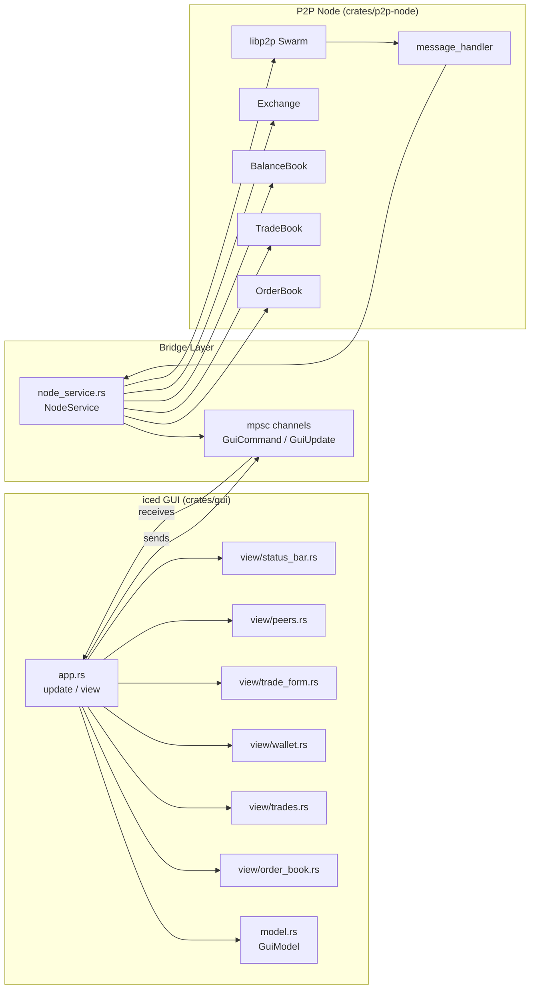

# Requirements

### Overview & Goals

Build a **native GUI application** for OpenDex — a P2P decentralized exchange built with `libp2p` (gossipsub, Kademlia DHT, noise encryption). The GUI will replace the current CLI-based interaction and provide a real-time trading dashboard for order books, trades, balances, and peer management.

### Scope

**In Scope:**
- New `crates/gui` workspace member with an **iced** (0.14) application
- Real-time order book display (bids/asks table sorted by price)
- Trade history panel with state progress visualization
- Wallet balance panel showing available/locked amounts per asset
- Trade execution form (buy/sell with price and amount)
- Peer connection management (dial, disconnect, status)
- Funding panel for adding test balances
- Internal `NodeService` bridging the GUI to the existing P2P node internals
- Shared `tokio::sync::mpsc` channels for event-driven updates

**Out of Scope:**
- Price charting / historical graphs (Phase 2)
- Multi-market support beyond BTC/XMR (Phase 2)
- Dispute resolution UI (Phase 2)
- Mobile support (Phase 2)

### User Stories

1. As a trader, I want to see the current order book so I can understand market depth.
2. As a trader, I want to place buy/sell orders from the GUI so I don't need a CLI.
3. As a trader, I want to see my wallet balances (available and locked) so I know what I can trade.
4. As a trader, I want to see active trades and their state so I can track settlement progress.
5. As a node operator, I want to connect to peers from the GUI so I can join the network.
6. As a node operator, I want to fund my wallet from the GUI for testing.

### Functional Requirements

| Feature | Description |
|---------|-------------|
| **Order Book** | Display bids (green) and asks (red) sorted by price; show amount and order ID |
| **Trade Execution** | Form with Side (Buy/Sell), Price, Amount fields; validates against balance |
| **Trade History** | List of trades with columns: ID, Market, Price, Amount, State, Timestamp |
| **Wallet Balances** | Show BTC and XMR balances split into Available and Locked |
| **Peer Management** | Input for multiaddr, connect button, list of connected peers with status |
| **Funding** | Dropdown for asset, amount input, fund button (local test balances) |
| **Node Status** | Display local PeerId, listening address, peer count |

### Non-Functional Requirements

- **Cross-platform**: Linux, macOS, Windows (iced native support)
- **Real-time updates**: UI refreshes within 100ms of P2P events via channels
- **No blocking**: GUI runs on separate thread; P2P swarm on tokio runtime
- **Consistent styling**: Dark theme suitable for trading dashboards

# Testing

### Current Implementation

The project is a **3-crate workspace**:

- **`crates/common`** — Shared domain types (Asset, Market, Side) — currently minimal
- **`crates/protocol`** — Message types: `Order`, `Trade`, `TradeState`, `Message`, `MessageType`, scales (`PRICE_SCALE`, `AMOUNT_SCALE`)
- **`crates/p2p-node`** — P2P node with:
  - `OrderBook` — order storage, matching, trade generation
  - `TradeBook` — trade lifecycle and state transitions
  - `BalanceBook` — balance tracking with lock/unlock for orders
  - `Exchange` — orchestrates order submission and trade application
  - `message_handler` — processes gossipsub messages and swarm events
  - `command_handler` — handles CLI commands (fund, order, cancel, balances, etc.)
  - `network` — libp2p swarm builder and message publishing
  - `main.rs` — `tokio::select!` loop multiplexing stdin commands and swarm events

**Key pattern**: The main loop in `main.rs` uses `tokio::select!` to handle both CLI input and P2P events. State is mutated directly in the loop via mutable references to `OrderBook`, `TradeBook`, and `BalanceBook`.

### Key Decisions

1. **iced 0.14** — Pure Rust, Elm Architecture (TEA), cross-platform, active development (System76/COSMIC). Fits naturally with the event-driven P2P design.

2. **Shared state via `Arc<Mutex<>>` + channels** — The P2P node internals will be wrapped in a `NodeService` that holds `Arc<Mutex<OrderBook>>`, `Arc<Mutex<TradeBook>>`, and `Arc<Mutex<BalanceBook>>`. The GUI subscribes to `tokio::sync::mpsc::Receiver` channels for real-time updates.

3. **New `crates/gui` crate** — Keeps the GUI separate from the P2P node. The gui crate depends on `p2p-node` (for types and node building) and `protocol` (for message types).

4. **Command channel pattern** — Instead of stdin, the GUI sends commands through a `tokio::sync::mpsc::Sender<GuiCommand>` channel. The P2P event loop receives from this channel instead of `stdin.lines()`.

### Architecture

```
graph LR
    G[iced GUI\nSubscription + Commands] -->|GuiCommand| CH[Command Channel]
    G -->|Updates| R[Receiver Channel]
    CH --> NS[NodeService]
    NS -->|mutates| OB[OrderBook]
    NS -->|mutates| TB[TradeBook]
    NS -->|mutates| BB[BalanceBook]
    NS -->|publishes| SW[libp2p Swarm]
    SW -->|events| NS
    NS -->|StateUpdate| R
    OB --> R
    TB --> R
    BB --> R
```

### Proposed Changes

#### New Crate: `crates/gui`

**Files:**
- `Cargo.toml` — dependencies: iced, tokio, p2p-node, protocol
- `src/main.rs` — iced application entry point
- `src/app.rs` — iced App struct, Message enum, update/view methods
- `src/model.rs` — GUI state model (order book view, trade list, balances, peers)
- `src/node_service.rs` — wraps P2P node, runs tokio runtime, channels
- `src/view/order_book.rs` — bid/ask table widget
- `src/view/trades.rs` — trade history widget
- `src/view/wallet.rs` — balance display widget
- `src/view/trade_form.rs` — buy/sell form widget
- `src/view/peers.rs` — peer management widget
- `src/view/status_bar.rs` — node status bar
- `src/style.rs` — dark theme styling

#### Modified: `crates/p2p-node`

**`src/lib.rs`:**
- Add `pub mod gui_bridge` — exports types needed by GUI
- Make `Exchange`, `OrderBook`, `TradeBook`, `BalanceBook` accessible behind `Arc<Mutex<>>`

**`src/gui_bridge.rs`** (new):
- `NodeService` struct wrapping the P2P event loop
- `GuiCommand` enum: PlaceOrder, CancelOrder, Fund, ShowBalances, ConnectPeer, etc.
- `GuiUpdate` enum: OrderBookUpdated, TradeAdded, BalanceChanged, PeerConnected, etc.
- `spawn_node()` function returning `(Sender<GuiCommand>, Receiver<GuiUpdate>)`

**`src/main.rs`:**
- Add `--gui` flag to launch the GUI instead of CLI mode
- When `--gui` is passed, spawn the node service and run the iced application

### Data Models

#### GuiCommand Enum
```
enum GuiCommand {
    PlaceOrder { side: Side, market: Market, price: f64, amount: f64 },
    CancelOrder { order_id: Uuid },
    Fund { asset: Asset, amount: f64 },
    ConnectPeer { multiaddr: String },
    RequestBalances,
    RequestOrderBook,
    RequestTrades,
    AdvanceTradeState { trade_id: Uuid, state: TradeState },
}
```

#### GuiUpdate Enum
```
enum GuiUpdate {
    OrderBookSnapshot(Vec<Order>),
    TradeAdded(Trade),
    TradeStateChanged { trade_id: Uuid, state: TradeState },
    BalancesUpdated(Vec<(Asset, Balance)>),
    PeerConnected(PeerId),
    PeerDisconnected(PeerId),
    OrderResult { order_id: Uuid, success: bool, error: Option<String> },
    LogMessage(String),
}
```

#### GuiModel Struct
```
struct GuiModel {
    order_book: OrderBookView,
    trades: Vec<TradeView>,
    balances: Vec<BalanceView>,
    peers: Vec<PeerView>,
    trade_form: TradeForm,
    command_tx: Sender<GuiCommand>,
    update_rx: flume::Receiver<GuiUpdate>,
    node_status: NodeStatus,
}
```

### File Structure

```
crates/gui/
├── Cargo.toml
└── src/
    ├── main.rs            # iced::Application entry
    ├── app.rs             # App trait impl (update, view, subscription)
    ├── model.rs           # GuiModel, OrderBookView, TradeView, etc.
    ├── node_service.rs    # NodeService, GuiCommand, GuiUpdate, spawn_node
    ├── style.rs           # Dark theme
    └── view/
        ├── mod.rs
        ├── order_book.rs  # Bid/ask table
        ├── trades.rs      # Trade history list
        ├── wallet.rs      # Balance panel
        ├── trade_form.rs  # Buy/sell form
        ├── peers.rs       # Peer management
        └── status_bar.rs  # Node status
```

### Risks

| Risk | Mitigation |
|------|-----------|
| iced 0.14 API changes | Pin to specific version; the API has stabilized recently |
| Mutex contention on shared state | Use `RwLock` for read-heavy operations (order book reads) |
| Channel backpressure | Use bounded channels with overflow logging |
| Complex state transitions in trades | Reuse existing `TradeState::can_transition_to()` validation |

# File Structure

### New Files

| File | Purpose |
|------|---------|
| `Cargo.toml` (workspace) | Add `crates/gui` to workspace members |
| `crates/gui/Cargo.toml` | GUI crate dependencies |
| `crates/gui/src/main.rs` | iced application entry point |
| `crates/gui/src/app.rs` | iced App trait implementation |
| `crates/gui/src/model.rs` | GUI state models |
| `crates/gui/src/node_service.rs` | NodeService bridging GUI to P2P node |
| `crates/gui/src/style.rs` | Dark theme styling |
| `crates/gui/src/view/mod.rs` | View module exports |
| `crates/gui/src/view/order_book.rs` | Order book table widget |
| `crates/gui/src/view/trades.rs` | Trade history widget |
| `crates/gui/src/view/wallet.rs` | Balance display widget |
| `crates/gui/src/view/trade_form.rs` | Trade execution form |
| `crates/gui/src/view/peers.rs` | Peer management widget |
| `crates/gui/src/view/status_bar.rs` | Node status bar |
| `crates/p2p-node/src/gui_bridge.rs` | Bridge module for GUI integration |

### Modified Files

| File | Changes |
|------|---------|
| `Cargo.toml` (workspace root) | Add `crates/gui` to members; add iced to workspace deps |
| `crates/p2p-node/Cargo.toml` | Add optional iced dependency |
| `crates/p2p-node/src/lib.rs` | Export `gui_bridge` module |
| `crates/p2p-node/src/main.rs` | Add `--gui` flag; conditional GUI launch |

### Architecture Diagram



# Delivery Steps

### ✓ Step 1: Set up GUI crate and workspace integration
Create the `crates/gui` workspace member with iced dependency, and add the `--gui` flag to `p2p-node`.
- Add `crates/gui` to workspace members in root `Cargo.toml`
- Create `crates/gui/Cargo.toml` with dependencies: iced (window, container, button, text_input, pick_list, subscription), tokio, p2p-node, protocol, flume
- Create `crates/p2p-node/src/gui_bridge.rs` with `GuiCommand` and `GuiUpdate` enums
- Update `crates/p2p-node/src/lib.rs` to export `gui_bridge` module
- Update `crates/p2p-node/src/main.rs` with `--gui` CLI flag and conditional GUI launch path
- Create skeleton `crates/gui/src/main.rs` with iced::Application entry point

### ✓ Step 2: Implement NodeService and channel-based communication
Build the bridge between the GUI and the P2P node using tokio channels.
- Implement `NodeService` struct in `crates/gui/src/node_service.rs` wrapping the P2P event loop
- Create `spawn_node()` function returning `(Sender<GuiCommand>, Receiver<GuiUpdate>)` channels
- Refactor the P2P event loop to accept commands from a channel instead of stdin
- Implement command handling for: PlaceOrder, CancelOrder, Fund, ConnectPeer, RequestBalances
- Implement update broadcasting for: OrderBookSnapshot, TradeAdded, BalancesUpdated, PeerConnected
- Ensure the node runs on a background tokio runtime separate from the iced GUI thread

### * Step 3: Implement GUI model and core app structure
Build the iced application model, message enum, and update/view methods.
- Create `crates/gui/src/model.rs` with `GuiModel` struct holding order book, trades, balances, peers, and form state
- Create `crates/gui/src/app.rs` implementing iced `Application` trait with `Message` enum, `update()`, `view()`, and `subscription()`
- Wire up `subscription()` to receive `GuiUpdate` events from the node service channel
- Implement `update()` to handle both GUI messages (button clicks, form submissions) and node updates
- Create `crates/gui/src/style.rs` with a dark theme (dark background, green for bids/buys, red for asks/sells)

###   Step 4: Build order book and trade form widgets
Implement the primary trading interface components.
- Create `crates/gui/src/view/order_book.rs` with bid/ask table showing Price, Amount, and Order ID columns, sorted by price
- Create `crates/gui/src/view/trade_form.rs` with Side selector (Buy/Sell), Price input, Amount input, and Submit/Cancel buttons
- Implement form validation: check balance sufficiency before submitting
- Create `crates/gui/src/view/trades.rs` with scrollable trade history showing ID, Market, Price, Amount, State, and Timestamp
- Wire all widgets into the main `view()` method in `app.rs` with a two-column layout (order book + form on left, trades on right)

###   Step 5: Build wallet, peers, and status bar widgets
Complete the remaining GUI panels for wallet, peer management, and node status.
- Create `crates/gui/src/view/wallet.rs` displaying BTC/XMR balances with Available and Locked columns
- Create `crates/gui/src/view/peers.rs` with multiaddr input, Connect button, and connected peer list with status indicators
- Create `crates/gui/src/view/status_bar.rs` showing local PeerId, listening address, and peer count
- Assemble the full layout: top status bar, main content area with panels, bottom wallet bar
- Test the complete application: place orders, view order book updates, check balances, connect peers