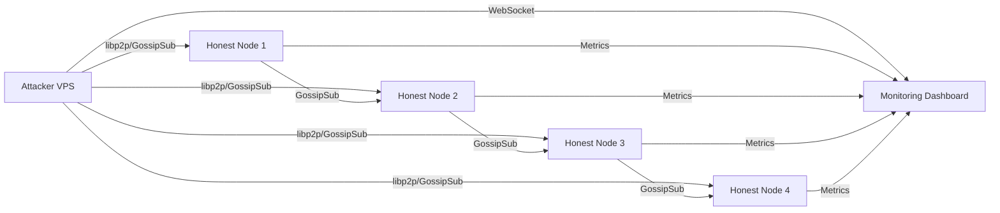

# Overview & Scope

### Overview
This plan creates a **Red Team Action Plan** document (`audit/red_team_plan.md`) that designs and specifies all red team testing infrastructure for OpenDex — to be deployed when cloud VPS and domain are ready. The plan bridges the gap between current in-process tests (692 unit tests, 13 fuzz targets, 26 adversarial scenarios) and real-world network-level penetration testing.

### Current State
- **In-process coverage**: 692 tests, 13 fuzz targets, 26 adversarial fiat scenarios, 15 p2p-node test files
- **Skipped tests**: `load_tests.rs` multi-node tests marked `#[ignore]` — require real infrastructure
- **Transport**: libp2p with GossipSub, Noise encryption, Kademlia DHT, Yamux multiplexing
- **Auth**: HMAC-SHA256 tokens, Argon2id password hashing, sliding-window rate limiter
- **Supply chain**: `cargo-deny` configured, 0 RUSTSEC vulnerabilities, no git dependencies
- **Key gap**: No end-to-end network-level testing; all current tests run in-process with `MockTransport`

### Scope
**In Scope:**
- Design a VPS-based testnet infrastructure for multi-node red team testing
- Define network-level attack scenarios (protocol fuzzing, gossipsub attacks, DoS)
- Specify cryptographic penetration tests against live nodes
- Plan fiat payment spoofing and cross-chain attack simulations
- Create an incident response and reporting workflow
- Define CI/CD integration for automated red team regression

**Out of Scope:**
- Social engineering tests (no human-facing attack surface yet)
- Physical security (cloud infrastructure)
- Third-party service penetration (Electrum, bank APIs — listed as out of scope in `security.md`)
- Formal verification (K Framework, TLA+) — deferred to post-audit

### Goals
1. Produce a single actionable document (`audit/red_team_plan.md`) that a team can execute when infrastructure is ready
2. Map every test scenario to concrete code paths, crates, and existing test files
3. Define infrastructure requirements (VPS specs, network topology, monitoring)
4. Establish a repeatable red team cycle with regression tracking

# Technical Design

### Current Implementation

**Test Infrastructure:**
- `fuzz/` — 13 fuzz targets via `cargo-fuzz`/libFuzzer targeting JSON deserialization of `Message`, `Order`, `Trade`, `TradeState`, `P2POffer`, `P2PTrade`, `FiatTrade`, `SettlementOps`, `AuthToken`, `Bond`, and state responses
- `crates/p2p-node/tests/` — 15 test files including `network_protocol_attacks.rs` (malformed messages, replay, identity spoofing), `crypto_penetration_tests.rs` (HMAC tokens, key management), `financial_logic_attacks.rs` (balance manipulation), `load_tests.rs` (multi-node mesh, message flood — all `#[ignore]`)
- `crates/fiat/tests/adversarial_tests.rs` — 26 adversarial fiat scenarios
- `crates/opendex-transport/tests/multi_node.rs` — 4 multi-node adversarial tests
- `crates/opendex-swap/tests/swap_e2e.rs` — 10 E2E integration tests

**Transport Layer** (`opendex-transport`):
- `ProtocolEnvelope` with `message_id` for replay protection, `sequence` for ordering
- `MessageStore` tracks seen message IDs per swap
- `Libp2pTransport` with serialize/deserialize envelope methods
- `Transport` trait: `send()` and `receive()` async methods

**Network Layer** (`p2p-node`):
- `network.rs`: `build_swarm()` configures libp2p with GossipSub, Kademlia, Noise, Identify, Ping
- `message_handler.rs`: `handle_gossipsub_message()` dispatches by `MessageType`
- `publish_message()` serializes to JSON, publishes via GossipSub

**Authentication** (`user`):
- `auth.rs`: `AuthService` with registration, login, HMAC-SHA256 token signing/validation
- `RateLimiter` with sliding window and max-key eviction

### Key Decisions

1. **Testnet topology**: 5-node star topology (1 attacker node + 4 honest nodes) on separate VPS instances, connected via libp2p over TCP with Noise encryption. This mirrors production while allowing controlled attack injection.

2. **Attacker node design**: A dedicated Rust crate (`red-team-agent`) that connects to the testnet as a legitimate peer, then injects adversarial messages through the same GossipSub channel honest peers use — testing the actual attack surface rather than a simulated one.

3. **Infrastructure-as-code**: All VPS provisioning, network configuration, and monitoring defined in Markdown checklists and shell scripts under `redteam/` — no Terraform/Ansible dependency to keep the plan self-contained.

4. **Regression integration**: Discovered vulnerabilities feed back into existing test files (`p2p-node/tests/`, `fiat/tests/`, `fuzz/fuzz_targets/`) as permanent regression tests.

### Proposed Changes

**New directory structure:**
```
audit/red_team_plan.md          # Main action plan document
redteam/                        # Red team infrastructure
├── README.md                   # Overview and quick start
├── infra/                      # Infrastructure setup
│   ├── vps_setup.sh            # VPS provisioning script
│   ├── docker-compose.yml      # Local testnet emulation
│   └── monitoring/             # Prometheus/Grafana configs
├── agent/                      # Attacker agent
│   ├── Cargo.toml              # red-team-agent crate
│   └── src/                    # Attack scenario implementations
│       ├── main.rs             # Agent entry point
│       ├── protocol_attacks.rs # Network/protocol attack scenarios
│       ├── crypto_attacks.rs   # Cryptographic attack scenarios
│       ├── dos_attacks.rs      # Denial of service scenarios
│       └── fiat_attacks.rs     # Fiat payment attack scenarios
├── scenarios/                  # Test scenario definitions
│   ├── network.md              # Network-level attack scenarios
│   ├── crypto.md               # Cryptographic attack scenarios
│   ├── application.md          # Application-level attack scenarios
│   └── fiat.md                 # Fiat-specific attack scenarios
└── reports/                    # Test results and findings
    └── template.md             # Report template
```

**Red Team Agent Architecture:**
The `red-team-agent` crate connects to the testnet as a libp2p peer, then executes attack scenarios by:
1. Publishing adversarial messages via GossipSub (same channel as honest peers)
2. Direct peer-to-peer message injection for targeted attacks
3. Monitoring honest node responses to measure defense effectiveness

**Scenario Categories:**

| Category | Target Crate | Existing Tests | New Scenarios |
|----------|-------------|----------------|---------------|
| Protocol attacks | `p2p-node`, `protocol` | `network_protocol_attacks.rs` | Live network replay, gossipsub flooding, topic manipulation |
| Crypto attacks | `user`, `fiat` | `crypto_penetration_tests.rs` | Live token replay, timing analysis, key extraction attempts |
| DoS attacks | `p2p-node`, `opendex-transport` | `load_tests.rs` (ignored) | Connection exhaustion, state bloat, resource starvation |
| Fiat attacks | `fiat` | `adversarial_tests.rs` | Live payment spoofing, race conditions, reversal attacks |
| Transport attacks | `opendex-transport` | `multi_node.rs` | Envelope tampering, sequence manipulation, MessageStore bypass |

### Architecture Diagram



### Risks
- **Testnet contamination**: Attacker node must be isolated from any mainnet or production network
- **Resource exhaustion**: DoS scenarios may crash VPS instances; monitoring and auto-restart required
- **False positives**: Network latency on VPS may cause timing-based tests to fail; thresholds must be calibrated
- **Key management**: Test keys must never leak to production; separate key stores enforced

# Delivery Plan

### Phase 1: Red Team Plan Document
Create `audit/red_team_plan.md` — the master action plan covering infrastructure requirements, scenario catalog, execution procedures, and reporting workflow. This document is the single source of truth for when the VPS and domain are ready.

### Phase 2: Red Team Infrastructure Skeleton
Create the `redteam/` directory structure with `README.md`, `infra/vps_setup.sh` (VPS provisioning checklist), `infra/docker-compose.yml` (local testnet emulation for development), and `reports/template.md` (finding report template).

### Phase 3: Red Team Agent Crate
Create the `redteam/agent/` crate with `Cargo.toml`, `src/main.rs` (agent entry point with libp2p swarm construction), and stub modules for `protocol_attacks.rs`, `crypto_attacks.rs`, `dos_attacks.rs`, and `fiat_attacks.rs` — each with scenario function signatures and documentation.

### Phase 4: Scenario Definitions
Create detailed scenario definition files under `redteam/scenarios/` — `network.md`, `crypto.md`, `application.md`, and `fiat.md` — each mapping attack scenarios to concrete code paths, expected behaviors, and validation criteria.

# Delivery Steps

### ✓ Step 1: Create red team plan document
Create `audit/red_team_plan.md` — the master red team action plan document.
- Define infrastructure requirements: VPS specs (4 honest nodes + 1 attacker node), network topology, domain configuration
- Catalog all attack scenario categories: protocol, crypto, DoS, fiat, transport, with references to existing test files
- Specify execution procedures: how to deploy, run scenarios, collect results, and report findings
- Define the regression workflow: how discovered issues feed back into existing test infrastructure
- Include monitoring setup: Prometheus metrics, Grafana dashboards, log aggregation
- Map each scenario to concrete code paths in `p2p-node`, `opendex-transport`, `user`, and `fiat` crates

### ✓ Step 2: Create red team infrastructure skeleton
Create the `redteam/` directory with infrastructure setup files.
- `redteam/README.md`: Overview, prerequisites, and quick-start guide for deploying the testnet
- `redteam/infra/vps_setup.sh`: Shell script that provisions VPS instances, installs Rust toolchain, configures firewall rules, and sets up libp2p networking
- `redteam/infra/docker-compose.yml`: Local Docker-based testnet emulation for development and CI (5 containers: 4 honest nodes + 1 attacker)
- `redteam/reports/template.md`: Structured report template with sections for scenario, severity, findings, evidence, and remediation

### ✓ Step 3: Create red team agent crate
Create the `redteam/agent/` Rust crate that connects to the testnet as an adversarial peer.
- `redteam/agent/Cargo.toml`: Dependencies on `libp2p`, `protocol`, `opendex-transport`, `opendex-types`, and `tokio`
- `redteam/agent/src/main.rs`: Agent entry point — constructs a libp2p swarm (reusing `p2p-node/network.rs::build_swarm`), connects to honest nodes, and dispatches attack scenarios
- `redteam/agent/src/protocol_attacks.rs`: Protocol-level attack scenarios — malformed message injection, replay attacks, sequence manipulation, topic hijacking
- `redteam/agent/src/crypto_attacks.rs`: Cryptographic attack scenarios — token replay, timing analysis, signature malleability against live nodes
- `redteam/agent/src/dos_attacks.rs`: DoS attack scenarios — connection flood, state bloat via MAX_PENDING_TRADE_STATES exhaustion, gossipsub mesh manipulation
- `redteam/agent/src/fiat_attacks.rs`: Fiat-specific attack scenarios — payment spoofing, race condition exploitation, reversal detection against live fiat trades

### ✓ Step 4: Create scenario definition documents
Create detailed scenario definitions under `redteam/scenarios/` with concrete attack vectors and validation criteria.
- `redteam/scenarios/network.md`: Network-level scenarios — gossipsub message flooding, Kademlia DHT poisoning, peer identity spoofing, connection exhaustion. Each scenario maps to code in `p2p-node/src/network.rs` and `p2p-node/src/message_handler.rs`
- `redteam/scenarios/crypto.md`: Cryptographic scenarios — HMAC token replay across nodes, timing side-channel measurement, key uniqueness verification on live instances. Maps to `user/src/auth.rs`
- `redteam/scenarios/application.md`: Application-level scenarios — state machine exploitation via live message sequences, balance manipulation through concurrent trades, MessageStore replay bypass. Maps to `opendex-transport/src/message_store.rs` and `p2p-node/src/trade_state.rs`
- `redteam/scenarios/fiat.md`: Fiat-specific scenarios — false payment detection via live bank adapter, chargeback/reversal simulation, 2-of-2 multisig edge cases. Maps to `fiat/src/trade.rs` and `fiat/src/settlement_engine.rs`