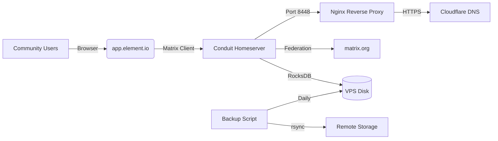

# Requirements

### Goal
Deploy a low-cost, cloud-hosted Matrix homeserver (Conduit) on a VPS for the OpenDex community chat, replacing the current reliance on `matrix.org` with an OpenDex-owned server (`#opendex:opendex.org`).

### Context
The OpenDex community chat currently uses `#opendex:matrix.org` (public Matrix server). The user wants a cloud-hosted VPS solution — not a home server — so the community chat runs on OpenDex's own infrastructure with full data sovereignty, custom `@user:opendex.org` handles, and privacy alignment with the project's values.

### User Stories
- As a community member, I want to join `#opendex:opendex.org` so that my chat data is hosted on OpenDex infrastructure, not a third-party server.
- As a project maintainer, I want to own the Matrix homeserver so that I control registration, moderation, and backups.
- As a privacy-conscious user, I want the chat server to align with OpenDex's values of data sovereignty and decentralization.

### Scope

**In Scope:**
- Create `docs/matrix/` directory with deployment assets (guide, Docker Compose, setup script, Nginx config, backup script)
- Deploy Conduit (Rust-based, lightweight) on a cheap cloud VPS (~$3.50–5/mo)
- Set up domain subdomain (e.g., `matrix.opendex.org`) with HTTPS via Certbot
- Create `#opendex:opendex.org` room and migrate from `#opendex:matrix.org`
- Update the web frontend Matrix link to point to the new room
- Update deployment docs to include the Matrix server section

**Out of Scope:**
- Element Web deployment (users access via `app.element.io` or their own client)
- Custom Matrix client development
- Production-grade high-availability (single VPS is sufficient for community-scale usage)

# Technical Design

### Current Implementation
- Community chat link in `crates/web-frontend/src/lib.rs` (ContactSection, line 755) points to `https://matrix.to/#/#opendex:matrix.org`
- README.md references the public Matrix chat
- No `docs/matrix/` directory currently exists (it was deleted in the previous session)
- Existing deployment infrastructure in `docs/deployment/` uses Nginx + Certbot for the static web portal

### Key Decisions

| Decision | Rationale |
|----------|-----------|
| **Conduit over Synapse** | Conduit is written in Rust, uses ~10% of the RAM of Synapse, and is designed for low-resource VPS deployment. Synapse requires 4GB+ RAM. |
| **RocksDB backend** | Conduit's default RocksDB (embedded) provides better performance than SQLite for federation workloads, with no separate database server needed. |
| **Docker deployment** | Simplifies updates, backups, and isolation from the existing Nginx static portal setup. Official image: `matrixconduit/matrix-conduit:v0.6.0`. |
| **Separate VPS** | A dedicated $3.50–5/mo VPS for the Matrix server avoids resource contention with the web portal VPS. |
| **Cloud provider** | Vultr ($3.50/mo), Host4Fun ($3/mo annual), or VPSMart ($4.50/mo) — all offer 1GB+ RAM, Ubuntu 24.04, and instant provisioning. |

### VPS Specifications

| Resource | Minimum | Recommended |
|----------|---------|-------------|
| CPU | 1 core | 2 cores |
| RAM | 1 GB (Conduit only) | 2 GB |
| Disk | 10 GB SSD | 25 GB SSD |
| OS | Ubuntu 24.04 LTS | Ubuntu 24.04 LTS |
| Provider | Vultr $3.50/mo, Host4Fun $3/mo, VPSMart $4.50/mo | Any |

### Monthly Cost Breakdown

| Scenario | Cost |
|----------|------|
| Static portal VPS (existing) | ~$5/mo |
| + Conduit on separate VPS | ~$3.50–5/mo |
| **Total** | **~$8.50–10/mo** |

### Proposed Changes

#### New Files

| File | Purpose |
|------|---------|
| `docs/matrix/README.md` | Comprehensive deployment guide covering Conduit installation, domain setup, HTTPS, room creation, and migration from matrix.org |
| `docs/matrix/docker-compose.yml` | Conduit homeserver container with RocksDB backend, volume mounts, and port mappings (8448 for federation) |
| `docs/matrix/setup-matrix.sh` | Automated VPS setup script (Docker install, domain config, Certbot HTTPS, Conduit config generation) |
| `docs/matrix/conduit.toml` | Conduit configuration template (server name, federation, registration, trusted servers) |
| `docs/matrix/nginx-matrix.conf` | Nginx reverse proxy config for Matrix federation traffic (port 8448) and `.well-known` discovery |
| `docs/matrix/backup.sh` | Daily RocksDB backup script with remote storage support |

#### Updated Files

| File | Change |
|------|--------|
| `crates/web-frontend/src/lib.rs` | Update Matrix link from `#opendex:matrix.org` to `#opendex:opendex.org` in ContactSection (line 755) |
| `README.md` | Add Matrix server deployment guide link to Documentation section |
| `docs/deployment/DEPLOY.md` | Add Matrix server deployment section |
| `docs/deployment/README.md` | Add reference to the Matrix homeserver guide |
| `crates/web-frontend/README.md` | Mention the Matrix infrastructure option |
| `CHANGELOG.md` | Add entry for Matrix VPS deployment guide |

### Architecture Diagram

### Risks & Mitigations

| Risk | Mitigation |
|------|-----------|
| Single point of failure | Regular backups via `backup.sh` to remote storage |
| Federation abuse | Rate limiting in Conduit config, UFW firewall rules |
| Data loss | Daily RocksDB backups, stored off-server |
| DDoS | Cloudflare proxy (free tier) in front of Matrix subdomain |
| Operational burden | Conduit requires minimal maintenance; document runbook in `docs/matrix/` |
| Room migration | Users must re-join the new room; announce migration period in advance |

# Delivery Steps

### ✓ Step 1: Create Matrix deployment documentation and assets
Create the `docs/matrix/` directory with all deployment assets.

- Create `docs/matrix/README.md` — comprehensive guide covering Conduit installation, domain setup, HTTPS via Certbot, room creation, and migration from `#opendex:matrix.org`
- Create `docs/matrix/docker-compose.yml` — Conduit homeserver container with RocksDB backend, volume mounts, and port mappings (8448 for federation, 6167 internal)
- Create `docs/matrix/setup-matrix.sh` — automated VPS setup script (Docker install, domain config, Certbot HTTPS, Conduit config generation)
- Create `docs/matrix/conduit.toml` — Conduit configuration template with server name, federation enabled, registration tokens, and trusted servers (`matrix.org`)
- Create `docs/matrix/nginx-matrix.conf` — Nginx reverse proxy config for Matrix federation traffic and `.well-known` discovery endpoints
- Create `docs/matrix/backup.sh` — daily RocksDB backup script with remote storage (rsync/S3) support

### ✓ Step 2: Update web frontend and project documentation
Update existing project files to reference the new cloud-hosted Matrix server.

- Update `crates/web-frontend/src/lib.rs` ContactSection (line 755) to link to `#opendex:opendex.org` instead of `#opendex:matrix.org`
- Update `README.md` to add the Matrix server deployment guide to the Documentation section
- Update `docs/deployment/DEPLOY.md` to include a Matrix server deployment section with quick start instructions
- Update `docs/deployment/README.md` to add a reference to the Matrix homeserver guide
- Update `crates/web-frontend/README.md` to mention the Matrix infrastructure option
- Update `CHANGELOG.md` to add an entry for the Matrix VPS deployment guide